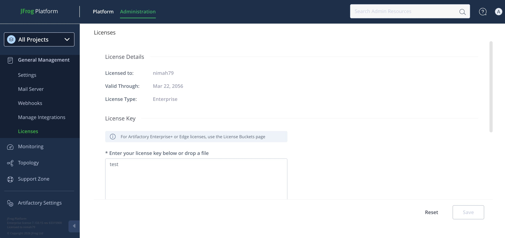

# [JFrog Artifactory](https://jfrog.com/artifactory/) License Patcher

A javaagent that returns a hardcoded license for [JFrog Artifactory](https://jfrog.com/artifactory/).

Latest tested version: [7.161.26](https://docs.jfrog.com/releases/docs/artifactory-self-managed-releases#artifactory-716126-self-managed) (also compatible with 7.133.x and 7.173.x+)

**⚠️ YOU SHOULD NEVER USE THIS PROJECT TO CRACK/PATCH/ ILLEGAL USE JFROG ARTIFACTORY. THIS PROJECT IS FOR EDUCATIONAL PURPOSES! THE CONSEQUENCES CAUSED BY THE USE OF THIS SOFTWARE SHALL BE BORNE BY THE USER.**

## Fixed Issues

This patcher addresses all known issues from:
- [nimah79/jfrog-artifactory-license-patcher](https://github.com/nimah79/jfrog-artifactory-license-patcher/issues)
- [Lama3L9R/ArtifactoryKeygen](https://github.com/Lama3L9R/ArtifactoryKeygen/issues)

Specifically fixed:
- **Enterprise Plus license type** (not just Enterprise) — enables evidence collection, HA, all E+ features
- **"Invalid license: last block incomplete in decryption"** errors in jfac (Access service) — Keys Management, Vault, Integrations, System Import now work
- **Xray product in license** — `/artifactory/api/xray/license` returns valid license
- **LDAP group sync** — `isPro()` returns true with Enterprise Plus license
- **HA mode support** — license type satisfies HA requirements
- **Distribution/JFConnect/Pipelines/Metadata/Evidence** product IDs included in hardcoded license
- **Version robustness** — works across 7.133.x, 7.161.x, and 7.173.x+ (tested on 7.133.15 and 7.161.26)

## Installation

1. Start the services using [Docker Compose](https://docs.docker.com/compose/):

```shell
docker compose up
```

2. In the JFrog Artifactory licenses page, write any random text and click "Save".



## Configuration

The patched license values are fully customizable via environment variables (preferred) or, as a fallback, JVM system properties. When neither is set, the hardcoded defaults below are used.

| Environment variable | System property | Description | Default |
|---|---|---|---|
| `LICENSE_OWNER` | `license.owner` | Owner/company shown on the licenses page | `nimah79` |
| `LICENSE_VALID_YEARS` | `license.validYears` | License duration in years (used when `LICENSE_EXPIRES` is not set) | `30` |
| `LICENSE_PRODUCT_IDS` | `license.productIds` | Comma-separated product IDs included in the license. `artifactory` must always be present. | `artifactory,xray,distribution,jfconnect,pipelines,mission-control,metadata,evidence` |
| `LICENSE_VALID_FROM` | `license.validFrom` | License start date, `yyyy-MM-dd` or `yyyy-MM-dd'T'HH:mm:ss` | now (at license creation) |
| `LICENSE_EXPIRES` | `license.expires` | License expiry date, same formats as above | `LICENSE_VALID_FROM` + `LICENSE_VALID_YEARS` years |
| `LICENSE_PRODUCT_TYPE` | `license.productType` | Product license type (multiplatform `Product.Type` enum name) | `ENTERPRISE_PLUS` |
| `LICENSE_LEGACY_TYPE` | `license.legacyType` | Legacy license type (`legacy.License.Type` enum name) | `HA` |
| `LICENSE_QUANTITY` | `license.quantity` | Legacy license quantity | `1000` |

Invalid values are logged as warnings and fall back to the defaults, so a bad configuration can never break startup. The agent prints the effective configuration to the log at startup (look for `[License Patcher] Effective license config: ...`).

### Examples

Environment variables (Docker Compose):

```yaml
services:
  artifactory:
    environment:
      - EXTRA_JAVA_OPTIONS=-javaagent:/opt/jfrog/artifactory/app/artifactory/jfrog-artifactory-license-patcher-1.0.jar
      - LICENSE_OWNER=Acme Corp
      - LICENSE_VALID_YEARS=100
      - LICENSE_PRODUCT_IDS=artifactory,xray
      - LICENSE_VALID_FROM=2026-01-01
      - LICENSE_EXPIRES=2126-01-01
```

JVM system properties (alternative to env, e.g. via `EXTRA_JAVA_OPTIONS` or `setenv.sh`):

```shell
EXTRA_JAVA_OPTIONS=-javaagent:/opt/jfrog/artifactory/app/artifactory/jfrog-artifactory-license-patcher-1.0.jar -Dlicense.owner="Acme Corp" -Dlicense.validYears=100
```

## Building the javaagent

The prebuilt jar file of the javaagent is available in `jfrog-artifactory-license-patcher-1.0.jar`. However, if you have modified the source code, you can build the jar file using the following command:

```shell
mvn clean package
```

## Notes

- The agent uses `LoaderClassPath` to access webapp classes during bytecode transformation — this is essential for patching to work correctly.
- All patches are fail-soft: if a class/method doesn't exist in a specific version, it's logged and skipped without breaking startup.
- Online license validation is disabled (`validateOnline=false`) to avoid external JFrog entitlement service calls.
- Xray itself is a native application (Go) and requires separate binary patching for full functionality — this agent only fixes the Artifactory-side `/artifactory/api/xray/license` endpoint.